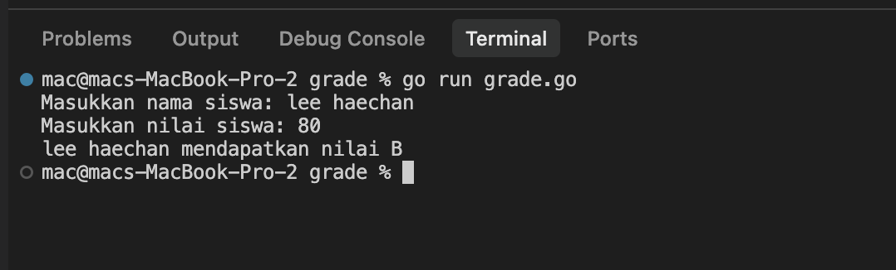
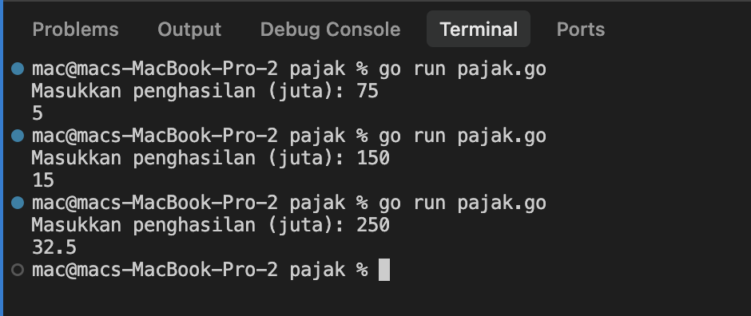

# <h1 align="center">Laporan Praktikum Modul 04 - Runtunan Sekuensial</h1>
<p align="center">Raihan Ahmad Rahmadhani - [109092600025]</p>

## Dasar Teori

### A. Alur Sekuensial 
Dalam pemrograman, program pada umumnya dieksekusi secara berurutan baris demi baris dari atas ke bawah (*runtunan/sequential flow*). Namun, untuk menyelesaikan masalah yang lebih kompleks, program sering kali memerlukan pengambilan keputusan (*selection/branching*). Struktur percabangan memungkinkan alur eksekusi kode dialihkan ke blok instruksi tertentu berdasarkan evaluasi suatu kondisi ekspresi boolean yang menghasilkan nilai `true` atau `false`.

### B. Operator Relasional dan Logika
1. **Operator Relasional (Perbandingan)**: Digunakan untuk membandingkan dua buah nilai atau variabel. Operator yang didukung oleh Go meliputi:
   - `==` (sama dengan)
   - `!=` (tidak sama dengan)
   - `<` (kurang dari) dan `>` (lebih dari)
   - `<=` (kurang dari atau sama dengan) dan `>=` (lebih dari atau sama dengan)
2. **Operator Logika**: Digunakan untuk mengombinasikan satu atau lebih ekspresi boolean:
   - `&&` (AND): Menghasilkan `true` hanya jika kedua kondisi yang dihubungkan bernilai `true`.
   - `||` (OR): Menghasilkan `true` jika salah satu atau kedua kondisi bernilai `true`.
   - `!` (NOT): Membalikkan nilai kebenaran suatu ekspresi (`!true` menjadi `false`, dan sebaliknya).
3. **Short-circuit Evaluation**: Go menerapkan evaluasi sirkuit pendek pada operator logika. Pada operasi `&&`, jika kondisi pertama bernilai `false`, maka kondisi kedua tidak akan dievaluasi lagi karena hasilnya sudah pasti `false`. Begitu pula pada operasi `||`, jika kondisi pertama bernilai `true`, kondisi kedua tidak akan diperiksa.

### C. Struktur Percabangan `if`, `else if`, dan `else`
Struktur `if` mengeksekusi blok kode di dalamnya apabila kondisi pengujian terpenuhi (`true`). Jika kondisi tidak terpenuhi, program dapat melanjutkan pengecekan ke blok `else if` berikutnya. Blok `else` bersifat opsional dan bertindak sebagai penampung akhir yang dieksekusi ketika semua kondisi di atasnya bernilai `false`.
Selain itu, Go juga mendukung **percabangan bersarang (*nested if*)**, yaitu penempatan pernyataan `if` di dalam blok `if` atau `else` lain untuk menangani alur keputusan bertingkat (seperti sistem menu dan validasi lanjutan).

### D. Struktur Pemilihan `switch - case`
Pernyataan `switch` menyediakan cara yang lebih rapi dan terstruktur untuk menulis percabangan banyak cabang (*multiple branching*) dibandingkan rantai `if - else if` yang panjang.
1. **Switch Berbasis Ekspresi**: Mencocokkan nilai variabel secara langsung dengan klausa `case`.
2. **Tagless Switch**: Pernyataan `switch` yang ditulis tanpa parameter variabel di samping kata kunci `switch`. Pada jenis ini, setiap klausa `case` mengevaluasi ekspresi boolean tersendiri.
3. Di Go, setelah suatu `case` terpenuhi dan blok kodenya dieksekusi, aliran program langsung keluar dari blok `switch` secara otomatis tanpa perlu menambahkan instruksi `break` manual. Blok `default` digunakan untuk menangani kondisi yang tidak tercakup oleh seluruh `case` yang ada.

## Guided

### 1. grade.go

```go
package main

import "fmt"

func main() {
	var nama1 string
	var nilai int

	fmt.Print("Masukkan nama siswa: ")
	fmt.Scan(&nama1)
	fmt.Print("Masukkan nilai siswa: ")
	fmt.Scan(&nilai)

	var grade string

	if nilai >= 90 && nilai <= 100 {
		grade = "A"
	} else if nilai >= 80 {
		grade = "B"
	} else if nilai >= 70 {
		grade = "C"
	} else if nilai >= 60 {
		grade = "D"
	} else {
		grade = "F"
	}

	fmt.Println(nama1, "mendapatkan nilai", grade)
}

```
#### Deskripsi
Program ini dibuat untuk menentukan grade nilai siswa berdasarkan input nama dan nilai angka. Program mengecek nilai tersebut menggunakan kondisi `if-else`: jika nilai 90 ke atas mendapat A, 80 ke atas mendapat B, 70 ke atas mendapat C, 60 ke atas mendapat D, dan di bawah 60 mendapat F. Setelah itu, nama dan grade siswa akan dicetak ke layar.

### 2. penilaian.go

```go
package main

import "fmt"

func main() {
	var opsi int

	fmt.Println("============== Menu ==============")
	fmt.Println("1. Sistem penilaian")
	fmt.Println("0. Keluar")
	fmt.Print("Pilih opsi: ")
	fmt.Scan(&opsi)

	if opsi == 1 {
		var nama1 string
		var nilai int

		fmt.Print("Masukkan nama siswa: ")
		fmt.Scan(&nama1)
		fmt.Print("Masukkan nilai siswa: ")
		fmt.Scan(&nilai)

		var grade string

		if nilai >= 90 && nilai <= 100 {
			grade = "A"
		} else if nilai >= 80 {
			grade = "B"
		} else if nilai >= 70 {
			grade = "C"
		} else if nilai >= 60 {
			grade = "D"
		} else {
			grade = "F"
		}

		fmt.Println(nama1, "mendapatkan nilai", grade)
	} else if opsi == 0 {
		fmt.Println("Keluar dari program.")
	} else {
		fmt.Println("Pilihan tidak valid.")
	}
}

```
#### Deskripsi
Program ini menampilkan menu sederhana dengan opsi 1 untuk sistem penilaian dan opsi 0 untuk keluar. Jika pengguna memilih opsi 1, program akan meminta input nama dan nilai siswa, lalu menentukan gradenya menggunakan percabangan `if-else` seperti program sebelumnya. Jika memilih opsi 0, program akan keluar, dan jika memilih angka lain akan muncul pesan bahwa pilihan tidak valid.

### 3. klasifikasi.go

```go
package main

import "fmt"

func main() {
	var usia int
	var gaji int

	fmt.Print("Masukkan usia: ")
	fmt.Scan(&usia)
	fmt.Print("Masukkan gaji tahunan (juta): ")
	fmt.Scan(&gaji)

	switch {
	case usia < 18:
		fmt.Println("Masih sekolah")
	case usia >= 18 && usia <= 25 && gaji >= 50:
		fmt.Println("Muda sukses")
	case usia >= 18 && usia <= 25 && gaji < 50:
		fmt.Println("Masih belajar hidup")
	case usia >= 26 && usia <= 40 && gaji >= 100:
		fmt.Println("Pekerja mapan")
	case usia >= 26 && usia <= 40 && gaji < 100:
		fmt.Println("Perlu perbaikan karier")
	case usia > 40 && gaji >= 150:
		fmt.Println("Profesional berpengalaman")
	case usia > 40 && gaji < 150:
		fmt.Println("Perlu evaluasi finansial")
	}
}
```
#### Deskripsi
Program ini digunakan untuk mengelompokkan status seseorang berdasarkan usia dan jumlah gaji tahunannya (dalam juta). Program mengecek kondisi tersebut menggunakan perintah `switch` dan operator `&&`, lalu menampilkan status yang sesuai ke layar, seperti "Masih sekolah", "Muda sukses", atau "Pekerja mapan".

## Unguided

### 1. grade.go

```go
package main

import "fmt"

func main() {
	var nama1, nama2 string
	var nilai int

	fmt.Print("Masukkan nama siswa: ")
	fmt.Scan(&nama1, &nama2)
	fmt.Print("Masukkan nilai siswa: ")
	fmt.Scan(&nilai)

	var grade string

	switch {
	case nilai >= 90 && nilai <= 100:
		grade = "A"
	case nilai >= 80:
		grade = "B"
	case nilai >= 70:
		grade = "C"
	case nilai >= 60:
		grade = "D"
	default:
		grade = "F"
	}

	fmt.Println(nama1, nama2, "mendapatkan nilai", grade)
}
```

##### Output


#### Deskripsi
Program ini berfungsi untuk menentukan grade nilai siswa menggunakan percabangan `switch`. Program membaca nama lengkap (dua kata) dan nilai siswa. Nilai tersebut dicek dari grade A sampai D, dan jika nilainya di bawah 60 akan masuk ke bagian `default` sehingga mendapat grade F. Terakhir, program mencetak nama siswa beserta grade yang diperoleh.

### 2. pajak.go

```go
package main

import "fmt"

func main() {
	var penghasilan float64

	fmt.Print("Masukkan penghasilan (juta): ")
	fmt.Scan(&penghasilan)

	var pajak float64

	if penghasilan <= 50 {
		pajak = 0.05 * penghasilan
	} else if penghasilan <= 100 {
		pajak = (0.05 * 50) + (0.10 * (penghasilan - 50))
	} else if penghasilan <= 200 {
		pajak = (0.05 * 50) + (0.10 * 50) + (0.15 * (penghasilan - 100))
	} else {
		pajak = (0.05 * 50) + (0.10 * 50) + (0.15 * 100) + (0.20 * (penghasilan - 200))
	}

	fmt.Println(pajak)
}
```

##### Output


#### Deskripsi
Program ini menghitung total pajak penghasilan tahunan secara bertingkat menggunakan percabangan `if-else`. Pengguna memasukkan penghasilan dalam satuan juta. Program kemudian menghitung potongan pajaknya sesuai batas tarif penghasilan (5%, 10%, 15%, dan 20%), lalu menampilkan hasil akhir pajak yang harus dibayar.

## Kesimpulan
Dari praktikum Modul 04 mengenai runtunan sekuensial dan struktur percabangan dalam bahasa pemrograman Go ini, dapat disimpulkan bahwa:
1. Alur eksekusi sekuensial (berurutan) dapat dikendalikan secara dinamis menggunakan struktur kontrol percabangan (*selection*) berdasarkan evaluasi kondisi boolean (`true` atau `false`).
2. Pemahaman mengenai operator perbandingan (`==`, `!=`, `<`, `>`, `<=`, `>=`) dan operator logika (`&&`, `||`, `!`), termasuk sifat *short-circuit evaluation*, sangat krusial dalam menyusun logika kondisi yang akurat pada program.
3. Struktur percabangan `if - else if - else` dan *nested if* (percabangan bersarang) efektif digunakan untuk memecahkan permasalahan yang melibatkan alur bertingkat, seperti pembuatan sistem menu interaktif dan perhitungan bertingkat (seperti skema pajak progresif).
4. Struktur pemilihan `switch-case` di bahasa Go memiliki fleksibilitas tinggi, khususnya fitur *tagless switch* yang mampu mengevaluasi kondisi majemuk secara elegan dan bersih (*clean code*). Fitur ini mengeliminasi kebutuhan kata kunci `break` manual serta menyediakan blok `default` untuk menangani kondisi di luar ekspektasi input.
