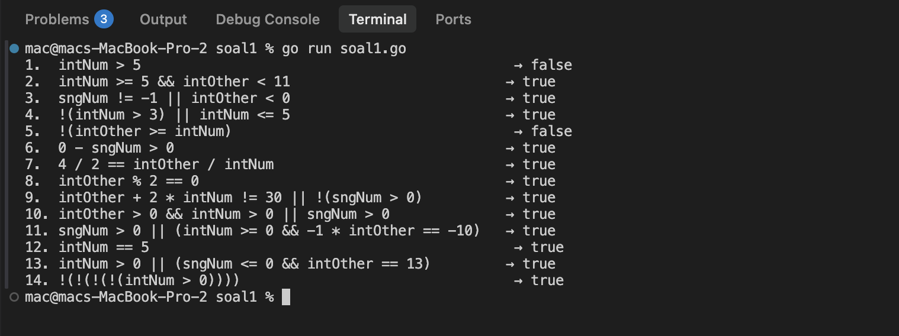
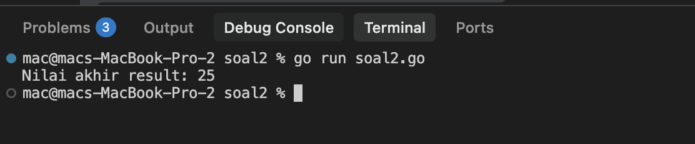
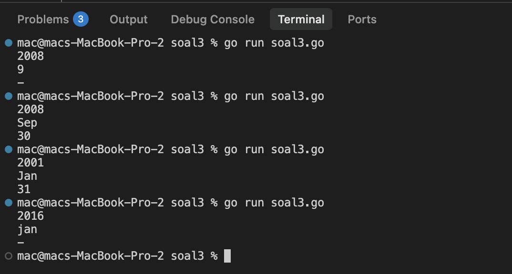
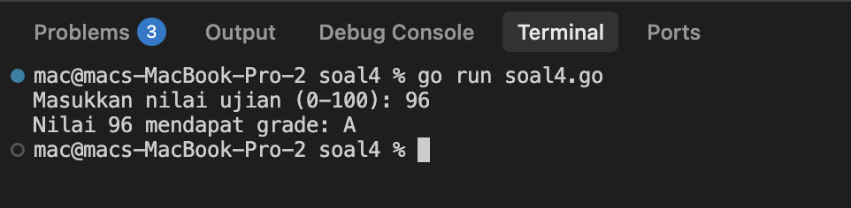

# <h1 align="center">Tugas Pendahuluan Modul 04 - Runtunan / Sekuensi</h1>
<p align="center">Raihan Ahmad Rahmadhani - 109092600025</p>

### 1. Evaluasi Ekspresi Kontrol dalam Go

```go
package main

import "fmt"

func main() {
	intNum := 5
	intOther := 10
	var sngNum float64 = -3

	fmt.Printf("1.  intNum > 5 → %v\n", intNum > 5)

	fmt.Printf("2.  intNum >= 5 && intOther < 11 → %v\n", intNum >= 5 && intOther < 11)

	fmt.Printf("3.  sngNum != -1 || intOther < 0 → %v\n", sngNum != -1 || intOther < 0)

	fmt.Printf("4.  !(intNum > 3) || intNum <= 5 → %v\n", !(intNum > 3) || intNum <= 5)

	fmt.Printf("5.  !(intOther >= intNum) → %v\n", !(intOther >= intNum))

	fmt.Printf("6.  0 - sngNum > 0 → %v\n", 0-sngNum > 0)

	fmt.Printf("7.  4 / 2 == intOther / intNum → %v\n", 4/2 == intOther/intNum)

	fmt.Printf("8.  intOther %% 2 == 0 → %v\n", intOther%2 == 0)

	fmt.Printf("9.  intOther + 2 * intNum != 30 || !(sngNum > 0) → %v\n", intOther+2*intNum != 30 || !(sngNum > 0))

	fmt.Printf("10. intOther > 0 && intNum > 0 || sngNum > 0 → %v\n", intOther > 0 && intNum > 0 || sngNum > 0)

	fmt.Printf("11. sngNum > 0 || (intNum >= 0 && -1 * intOther == -10) → %v\n", sngNum > 0 || (intNum >= 0 && -1*intOther == -10))

	fmt.Printf("12. intNum == 5 → %v\n", intNum == 5)

	fmt.Printf("13. intNum > 0 || (sngNum <= 0 && intOther == 13) → %v\n", intNum > 0 || (sngNum <= 0 && intOther == 13))

	fmt.Printf("14. !(!(!(!(intNum > 0)))) → %v\n", !(!(!(!(intNum > 0)))))
}

```

##### Output



#### Deskripsi
Pada soal pertama, program dibuat untuk mengevaluasi 14 bentuk ekspresi kontrol/logika dalam bahasa Go dengan nilai awal variabel `intNum = 5`, `intOther = 10`, dan `sngNum = -3`. Program ini menguji pemahaman operator perbandingan (`>`, `<`, `>=`, `<=`, `==`, `!=`), operator logika (`&&`, `||`, `!`), serta aturan prioritas dan *short-circuit evaluation*. Dari 14 ekspresi yang diuji, hanya nomor 1 (`intNum > 5`) dan nomor 5 (`!(intOther >= intNum)`) yang bernilai `false`, sedangkan 12 ekspresi lainnya bernilai `true`.

---

### 2. Tracing: Evaluasi Pernyataan Kondisi

```go
package main

import "fmt"

func main() {
	x := 10
	y := 5
	z := 15
	result := 0

	if x > 5 {
		if y < 10 {
			result = x + y 
		} else {
			result = x - y
		}
	}

	if z > 10 && x == 10 {
		result += z 
	} else {
		result = z - x
	}

	if x == 10 || y > 10 {
		result += 5 
	} else if y == 5 && z > 10 {
		result -= 5
	} else {
		result *= 2
	}

	if !(x < 15 && y < 10) {
		result += 10
	} else {
		result -= 10
	}

	fmt.Println("Nilai akhir result:", result)
}

```

##### Output



#### Deskripsi
Pada soal kedua, program melakukan penelusuran (*tracing*) alur eksekusi percabangan secara beruntun (*sequential*) terhadap variabel `result` dengan nilai awal `x = 10`, `y = 5`, `z = 15`, dan `result = 0`:
1. **Kondisi 1 (`x > 5`):** Bernilai `true` ($10 > 5$). Di dalamnya, kondisi nested `y < 10` ($5 < 10$) juga bernilai `true`, sehingga dieksekusi `result = x + y` ($10 + 5$), mengubah `result` menjadi **15**.
2. **Kondisi 2 (`z > 10 && x == 10`):** Bernilai `true` karena $15 > 10$ dan $10 == 10$. Operasi `result += z` dijalankan, sehingga `result` menjadi $15 + 15 =$ **30**.
3. **Kondisi 3 (`x == 10 || y > 10`):** Bernilai `true` karena $10 == 10$. Operasi `result += 5` dijalankan, sehingga `result` menjadi $30 + 5 =$ **35**, sementara blok `else if` dan `else` dilewati.
4. **Kondisi 4 (`!(x < 15 && y < 10)`):** Bagian dalam kurung bernilai `true`, namun dengan negasi `!` menghasilkan `false`. Oleh karena itu, percabangan masuk ke blok `else` dan menjalankan `result -= 10`, sehingga nilai akhir `result` menjadi $35 - 10 =$ **25**. Output akhir yang dicetak adalah `Nilai akhir result: 25`.

---

### 3. Menentukan Jumlah Hari dalam Sebulan Berdasarkan Tahun dan Bulan

```go
package main

import "fmt"

func main() {
	var tahun int
	var bulan string

	fmt.Scan(&tahun, &bulan)

	kabisat := (tahun%4 == 0 && tahun%100 != 0) || (tahun%400 == 0)

	var jumlahHari int
	valid := true

	switch bulan {
	case "Jan", "Mar", "Mei", "Jul", "Agu", "Okt", "Des":
		jumlahHari = 31
	case "Apr", "Jun", "Sep", "Nov":
		jumlahHari = 30
	case "Feb":
		if kabisat {
			jumlahHari = 29
		} else {
			jumlahHari = 28
		}
	default:
		valid = false
	}

	if valid {
		fmt.Println(jumlahHari)
	} else {
		fmt.Println("-")
	}
}

```

##### Output



#### Deskripsi
Pada soal ketiga, saya membuat program untuk menentukan jumlah hari dalam suatu bulan berdasarkan input `tahun` (tipe `int`) dan tiga huruf singkatan `bulan` (tipe `string` dengan huruf pertama kapital). 
- Pertama, program memeriksa status tahun kabisat menggunakan rumus `(tahun%4 == 0 && tahun%100 != 0) || (tahun%400 == 0)`.
- Selanjutnya, struktur `switch-case` digunakan untuk mengelompokkan jumlah hari: bulan dengan 31 hari (`Jan`, `Mar`, `Mei`, `Jul`, `Agu`, `Okt`, `Des`), bulan dengan 30 hari (`Apr`, `Jun`, `Sep`, `Nov`), dan bulan `Feb` yang bernilai 29 hari jika kabisat atau 28 hari jika bukan kabisat.
- Jika nama bulan tidak sesuai format (misalnya huruf kecil `"jan"`), program masuk ke bagian `default` dan mencetak tanda `-`.

---

### 4. Switch Case

```go
package main

import "fmt"

func main() {
	var nilai int

	fmt.Print("Masukkan nilai ujian (0-100): ")
	fmt.Scan(&nilai)

	var grade string

	switch {
	case nilai >= 90 && nilai <= 100:
		grade = "A"
	case nilai >= 80:
		grade = "B"
	case nilai >= 70:
		grade = "C"
	case nilai >= 60:
		grade = "D"
	case nilai >= 0:
		grade = "E"
	default:
		fmt.Println("Nilai tidak valid!")
		return
	}

	fmt.Printf("Nilai %d mendapat grade: %s\n", nilai, grade)
}
```

##### Output



#### Deskripsi
Pada program keempat, saya membuat contoh implementasi struktur `switch case` dalam bahasa Go untuk mengonversi nilai angka ujian (rentang 0-100) menjadi indeks huruf (*grade*). Program ini menggunakan *tagless switch* (switch tanpa ekspresi di header) di mana setiap klausa `case` mengevaluasi kondisi boolean. Program juga dilengkapi penanganan input di luar jangkauan (angka di bawah 0 atau di atas 100) melalui blok `default` yang menampilkan pesan bahwa nilai tidak valid.

---

## Kesimpulan
Dari pengerjaan tugas pendahuluan modul 04 tentang runtunan dan sekuensi percabangan ini, beberapa hal yang saya pelajari dan pahami antara lain:
1. Memahami cara kerja evaluasi ekspresi kondisi menggunakan kombinasi operator logika (`&&`, `||`, `!`) serta operator relasional, termasuk sifat *short-circuit evaluation* yang menghentikan pengecekan jika hasil sudah dapat ditentukan.
2. Memahami alur eksekusi runtunan bersyarat menggunakan struktur `if`, `if-else`, dan `nested if` (percabangan bersarang) serta pengaruh urutan eksekusi terhadap nilai variabel.
3. Menguasai struktur percabangan `switch-case` pada Go, baik menggunakan pencocokan nilai string secara langsung (*multiple case values*) maupun *tagless switch* dengan pengujian kondisi boolean dinamis untuk menyederhanakan kode dibandingkan penggunaan `if-else if` bertingkat yang panjang.
