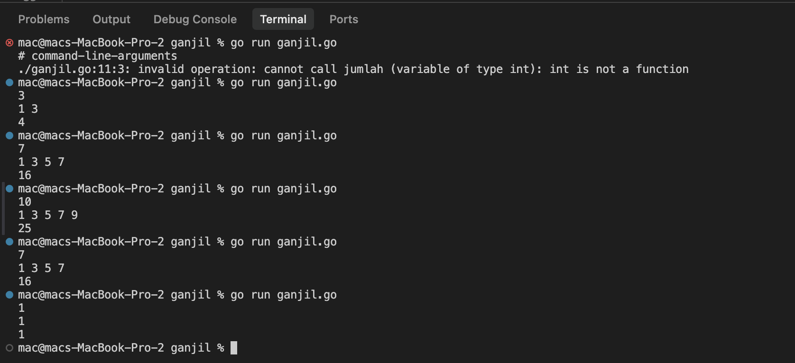
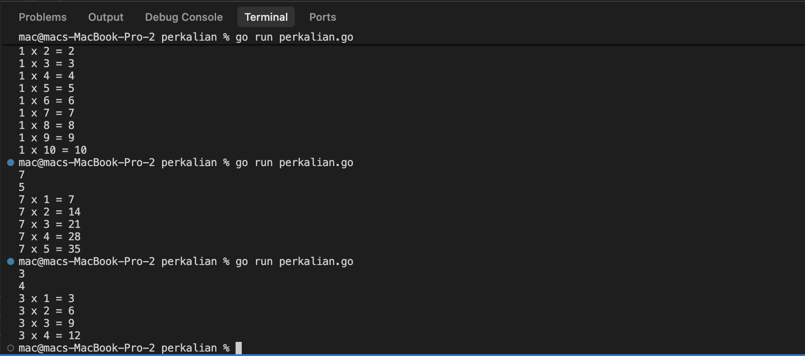

# <h1 align="center">Tugas Pendahuluan Modul 05 - Perulangan / For Loop</h1>
<p align="center">Raihan Ahmad Rahmadhani - 109092600025</p>

### 1. Fungsi Utama Perulangan for dan Tiga Komponennya

#### Deskripsi
Perulangan `for` di bahasa Go berfungsi untuk mengeksekusi blok kode secara berulang selama syarat atau kondisi yang kita tentukan masih terpenuhi. Di pemrograman, perulangan ini sangat membantu supaya kita tidak perlu mengetik perintah yang sama berkali-kali secara manual. Program jadi jauh lebih pendek, rapi, dan mudah diatur, apalagi kalau kita harus memproses banyak data atau deret angka.

Format standar `for` di Go memakai tiga komponen yang dipisahkan tanda titik koma (`;`):

```go
for inisialisasi; kondisi; post_statement {
    // blok kode yang dijalankan berulang
}
```

Penjelasan ketiga komponennya:
- **Inisialisasi (`i := 1`):** Dijalankan sekali saja di awal sebelum perulangan mulai. Tujuannya untuk membuat dan memberi nilai awal ke variabel penghitung (*counter*). Variabel yang dideklarasikan di sini sifatnya lokal, jadi cuma bisa dipakai di dalam blok `for` tersebut.
- **Kondisi (`i <= 5`):** Pengecekan logika boolean yang dites tiap kali sebelum isi perulangan dieksekusi. Selama hasilnya bernilai `true`, kode di dalam kurung kurawal bakal terus jalan. Tapi begitu nilainya `false`, perulangan langsung berhenti.
- **Post statement (`i++`):** Perintah yang otomatis jalan di akhir tiap putaran setelah semua baris di dalam blok selesai dijalankan. Fungsinya buat mengubah nilai variabel counter (bisa ditambah atau dikurang) supaya hitungannya bergerak maju dan tidak terkena *infinite loop*.

Alur eksekusinya: inisialisasi jalan sekali di awal $\rightarrow$ cek kondisi $\rightarrow$ kalau benar, jalankan isi perulangan $\rightarrow$ jalankan post statement $\rightarrow$ cek kondisi lagi, dan begitu seterusnya sampai kondisi salah.

---

### 2. Perbedaan for dengan Tiga Komponen dan for dengan Kondisi Saja

#### Deskripsi
Waktu dulu belajar bahasa pemrograman seperti C++ atau Java, biasanya kita memakai `while` atau `do-while` untuk perulangan bersyarat. Di Go, sintaks tersebut sengaja dihilangkan. Pengembang Go menyederhanakannya sehingga hanya ada satu kata kunci perulangan, yaitu `for`. Meskipun cuma ada satu kata kunci, variasinya tetap fleksibel.

Perbedaan mendasarnya:
1. **`for` dengan tiga komponen (`for init; cond; post`):** Inisialisasi, kondisi, dan penambahan nilainya ditulis sekaligus di baris kepala `for`. Bentuk ini biasanya dipakai kalau batas perulangannya sudah pasti dari awal (*definite loop*), misalnya mengulang 5 kali atau 10 kali.
2. **`for` hanya dengan kondisi (`for cond`):** Bentuk ini fungsinya persis seperti `while`. Kita cuma menuliskan syarat berhentinya saja di samping kata `for`. Variabel awalnya dibuat sebelum perulangan, lalu perubahannya harus ditulis manual di dalam badan perulangan. Bentuk ini cocok dipakai saat jumlah putarannya belum pasti karena bergantung pada kondisi dinamis program.

---

#### A. Contoh Kode: `for` dengan Tiga Komponen

```go
package main

import "fmt"

func main() {
    for i := 1; i <= 5; i++ {
        fmt.Println(i)
    }
}
```

**Penjelasan baris kodenya:**
- `package main` dan `import "fmt"`: Menentukan paket utama dan mengimpor pustaka untuk mencetak teks.
- `for i := 1; i <= 5; i++`: Loop langsung menyiapkan nilai awal `i = 1`, batas `i <= 5`, dan penambahan `i++` pada satu baris.
- `fmt.Println(i)`: Mencetak angka `i` ke terminal pada setiap putaran.

**Output:**
```text
1
2
3
4
5
```

---

#### B. Contoh Kode: `for` Hanya dengan Kondisi (Pengganti While)

```go
package main

import "fmt"

func main() {
    i := 1

    for i <= 5 {
        fmt.Println(i)
        i++
    }
}
```

**Penjelasan baris kodenya:**
- `i := 1`: Nilai awal variabel disiapkan di luar, sebelum blok `for`.
- `for i <= 5`: Perulangan hanya memeriksa kondisi nilai `i`, sama persis seperti cara kerja `while (i <= 5)`.
- `i++`: Nilai `i` dinaikkan manual di dalam blok perulangan supaya perulangan bisa mencapai kondisi berhenti.

**Output:**
```text
1
2
3
4
5
```

Perbandingan ringkasnya: bentuk tiga komponen lebih praktis buat perulangan terhitung dengan variabel lokal di kepala `for`. Sedangkan bentuk kondisi saja membuat variabelnya tetap bisa dibaca di luar loop dan lebih fleksibel untuk kondisi yang mirip `while`.

---

### 3. ganjil.go

```go
package main 

import "fmt"

func main() {
	var n int
	jumlah := 0

	fmt.Scan(&n)
	for i := 1; i <= n; i += 2 {
		fmt.Print(i, " ") 
		jumlah += i 
	}
	fmt.Println()
	fmt.Println(jumlah)
}
```

##### Output



#### Deskripsi
Program `ganjil.go` ini dibuat untuk menampilkan deret bilangan ganjil dari angka 1 sampai batas angka `n` yang dimasukkan oleh pengguna, lalu di baris bawahnya menampilkan total hasil penjumlahan semua bilangan ganjil tersebut.

Alur logika yang saya gunakan pada program ini:
1. Pertama, program menerima masukan bilangan bulat positif `n` lewat perintah `fmt.Scan(&n)` dan menyiapkan variabel `jumlah` bernilai 0 untuk menampung total penjumlahan.
2. Di bagian perulangan `for`, saya mulai dengan `i := 1` dan memberi batasan `i <= n`.
3. Pada post statement, saya sengaja memakai `i += 2` bukan `i++`. Karena selisih bilangan ganjil selalu 2 (1, 3, 5, 7, dan seterusnya), nilai `i` langsung loncat melewati angka genap. Cara ini lebih praktis dan hemat logika karena saya tidak perlu menambahkan percabangan `if i % 2 != 0` lagi di dalam loop.
4. Di dalam loop, tiap angka ganjil dicetak ke samping dengan spasi lewat `fmt.Print(i, " ")`, sekaligus langsung ditambahkan ke variabel total lewat `jumlah += i`.
5. Begitu perulangan selesai, `fmt.Println()` dipanggil untuk berpindah baris, lalu `fmt.Println(jumlah)` mencetak hasil total penjumlahannya.

**Contoh penelusuran (*tracing*) ketika input $n = 10$:**
- Putaran 1: $i = 1 \le 10 \rightarrow$ cetak `1 `, nilai `jumlah` $= 0 + 1 = 1$
- Putaran 2: $i = 3 \le 10 \rightarrow$ cetak `3 `, nilai `jumlah` $= 1 + 3 = 4$
- Putaran 3: $i = 5 \le 10 \rightarrow$ cetak `5 `, nilai `jumlah` $= 4 + 5 = 9$
- Putaran 4: $i = 7 \le 10 \rightarrow$ cetak `7 `, nilai `jumlah` $= 9 + 7 = 16$
- Putaran 5: $i = 9 \le 10 \rightarrow$ cetak `9 `, nilai `jumlah` $= 16 + 9 = 25$
- Putaran 6: $i = 11$, karena $11 \le 10$ bernilai salah, perulangan berhenti.

Hasil keluarannya:
```text
1 3 5 7 9 
25
```

---

### 4. perkalian.go

```go
package main 

import "fmt" 

func main() {
	var a, b int
	fmt.Scan(&a, &b)

	for i := 1; i <= b; i++ {
		fmt.Printf("%d x %d = %d\n", a, i, a*i)
	}
}
```

##### Output



#### Deskripsi
Program `perkalian.go` ini berfungsi menampilkan tabel perkalian dari bilangan `a` mulai dari pengali 1 hingga batas pengali `b`.

Cara kerja kodenya:
1. Program membaca dua input bilangan bulat `a` dan `b` sekaligus menggunakan `fmt.Scan(&a, &b)`. Variabel `a` adalah angka dasarnya, sedangkan `b` adalah jumlah baris perkalian yang diinginkan.
2. Perulangan diatur mulai dari `i := 1` sampai `i <= b` dengan kenaikan satu per satu (`i++`), jadi loop akan berputar tepat sebanyak `b` kali.
3. Supaya format baris perkaliannya rapi sesuai contoh soal, saya memakai `fmt.Printf("%d x %d = %d\n", a, i, a*i)`. Format `%d` pertama diisi oleh angka dasar `a`, `%d` kedua diisi nilai pengali putaran `i`, dan `%d` ketiga langsung diisi hasil perkalian `a*i`. Karakter `\n` dipakai untuk membuat baris baru setelah setiap persamaan selesai dicetak.

**Contoh penelusuran (*tracing*) ketika input $a = 7$ dan $b = 5$:**
- Putaran 1: $i = 1 \le 5 \rightarrow$ cetak `7 x 1 = 7`
- Putaran 2: $i = 2 \le 5 \rightarrow$ cetak `7 x 2 = 14`
- Putaran 3: $i = 3 \le 5 \rightarrow$ cetak `7 x 3 = 21`
- Putaran 4: $i = 4 \le 5 \rightarrow$ cetak `7 x 4 = 28`
- Putaran 5: $i = 5 \le 5 \rightarrow$ cetak `7 x 5 = 35`
- Putaran 6: $i = 6$, kondisi sudah lewat batas, perulangan berhenti.

Hasil keluarannya:
```text
7 x 1 = 7
7 x 2 = 14
7 x 3 = 21
7 x 4 = 28
7 x 5 = 35
```

---

## Kesimpulan
Dari tugas pendahuluan modul 05 ini, beberapa hal yang saya dapatkan:
1. Bahasa Go menyederhanakan perulangan dengan hanya memakai satu kata kunci `for`. Walaupun tidak ada `while` atau `do-while`, fungsi perulangan di Go tetap lengkap dan fleksibel.
2. Tiga bagian utama pada `for` (inisialisasi, kondisi, post statement) saling terhubung untuk mengatur jalannya putaran agar program tidak macet karena *infinite loop*.
3. Perubahan nilai pada post statement bisa disesuaikan dengan pola kebutuhan, misalnya memakai `i += 2` untuk langsung menyaring deret bilangan ganjil tanpa perlu pengecekan kondisi if tambahan.
4. Perulangan `for` mempermudah tugas komputasi berulang, baik untuk proses penambahan nilai total (*akumulator*) maupun untuk menampilkan data dalam bentuk tabel yang rapi.
