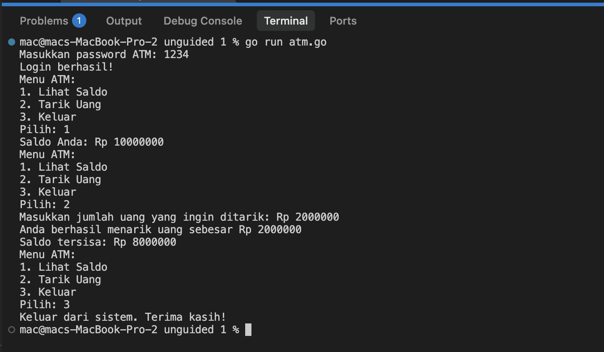

# <h1 align="center">Laporan Praktikum Modul 06 - Perulangan While Loop dan Repeat</h1>
<p align="center">Raihan Ahmad Rahmadhani - 109092600025</p>

## Dasar Teori

### A. Konsep Perulangan Kondisional (*While Loop*)
Perulangan (*looping*) merupakan salah satu struktur kontrol paling penting dalam pemrograman yang memungkinkan sekumpulan instruksi dieksekusi secara berulang selama suatu kondisi tertentu masih terpenuhi (*true*). Secara umum, perulangan terbagi menjadi dua kategori:
1. **Counted Loop**: Perulangan yang jumlah iterasinya telah diketahui secara pasti sebelum perulangan dieksekusi (umumnya menggunakan variabel pencacah seperti pada `for` tradisional).
2. **Uncounted / Conditional Loop**: Perulangan yang jumlah iterasinya tidak diketahui secara pasti di awal, melainkan bergantung pada evaluasi ekspresi kondisi boolean di setiap putaran iterasi. Struktur ini lazim disebut sebagai *while loop*.

Struktur *while loop* tergolong ke dalam jenis *entry-controlled loop*, yang berarti ekspresi kondisi akan diuji terlebih dahulu sebelum blok kode di dalamnya dieksekusi. Jika pada pemeriksaan pertama kondisi sudah bernilai `false`, maka badan perulangan tidak akan pernah dijalankan sama sekali.

### B. Implementasi Perulangan While dalam Bahasa Go
Bahasa pemrograman Go dirancang dengan prinsip kesederhanaan dan kejelasan sintaksis. Oleh karena itu, Go tidak memiliki kata kunci khusus seperti `while` maupun `do-while`. Seluruh bentuk perulangan di Go direpresentasikan secara terpadu melalui kata kunci tunggal, yaitu `for`.

Untuk mengimplementasikan perulangan *while* di Go, kita cukup menuliskan kata kunci `for` yang hanya diikuti oleh satu ekspresi kondisi boolean tanpa bagian *init statement* maupun *post statement*:
```go
for kondisi {
    // instruksi yang diulang selama kondisi bernilai true
}
```
Instruksi di dalam kurung kurawal `{}` akan terus diulang selama ekspresi `kondisi` menghasilkan nilai `true`, dan perulangan akan terhenti begitu kondisi menghasilkan nilai `false`.

### C. Komponen Kritis dan Pencegahan *Infinite Loop*
Dalam merancang perulangan berbasis kondisi, terdapat tiga komponen kritis yang wajib diperhatikan:
1. **Inisialisasi Variabel Pengendali (*State Initialization*)**: Variabel yang menentukan kondisi perulangan harus memiliki nilai awal sebelum memasuki blok `for`.
2. **Kondisi Berhenti (*Loop Condition*)**: Ekspresi pembanding yang menentukan apakah perulangan harus berlanjut atau berhenti.
3. **Pembaruan Nilai (*Update/Step Statement*)**: Di dalam badan perulangan, harus ada operasi yang mengubah nilai variabel pengendali (misalnya penambahan/pengurangan nilai seperti `n++`, atau pembacaan masukan baru dari pengguna).

Jika variabel pengendali tidak pernah diperbarui di dalam badan loop, ekspresi kondisi akan selalu bernilai `true`. Hal ini mengakibatkan terjadinya **perulangan tanpa henti (*infinite loop*)** yang dapat menyebabkan program mengalami *hang*, membekukan terminal, dan menghabiskan sumber daya komputasi.

### D. Konsep *Repeat-Until* (*Post-Condition Loop*) di Bahasa Go
Selain *while loop*, terdapat pula konsep perulangan *repeat-until* atau *do-while* yang tergolong sebagai *post-condition loop*. Pada struktur ini, blok instruksi dijamin akan dieksekusi minimal satu kali terlebih dahulu sebelum kondisi evaluasi diuji di bagian akhir iterasi.

Meskipun Go tidak memiliki sintaks bawaan `do-while`, perilaku ini dapat dicapai di Go melalui beberapa pendekatan:
1. Menggunakan perulangan tak terbatas `for { ... }` yang dipadukan dengan evaluasi kondisi di akhir blok menggunakan percabangan `if` dan kata kunci `break` untuk keluar dari perulangan.
2. Menginisialisasi nilai variabel kondisi sedemikian rupa sehingga evaluasi pada awal `for kondisi` selalu bernilai `true` pada iterasi pertama.

### E. Pembacaan Masukan Berupa Baris/Kalimat Menggunakan `bufio.NewReader`
Fungsi masukan standar `fmt.Scan` membaca input dengan pemisah spasi (*whitespace-delimited*). Apabila program memerlukan input berupa kalimat lengkap yang memuat karakter spasi (misalnya `"Belajar Golang"`), `fmt.Scan` hanya akan menangkap kata pertama saja.

Untuk membaca seluruh baris input teks hingga karakter *newline* (`\n`), digunakan kombinasi paket `bufio` dan `os`:
```go
reader := bufio.NewReader(os.Stdin)
kalimat, _ := reader.ReadString('\n')
```
Panjang keseluruhan string dapat dihitung menggunakan fungsi bawaan `len(kalimat)`, dan setiap karakter dapat diakses menggunakan indeks `kalimat[i]` untuk diproses karakter demi karakter menggunakan perulangan kondisional.

---

## Guided

### 1. terkecil.go

```go
package main

import "fmt"

func main() {
    var batas int
    fmt.Scan(&batas)

    n := 1
    for n*n*n <= batas {
        n++
    }

    fmt.Println(n)
}
```

#### Deskripsi
Program `terkecil.go` ini berfungsi untuk mencari bilangan bulat positif terkecil $n$ sedemikian rupa sehingga nilai kubik dari $n$ ($n^3$) bernilai lebih besar dari suatu nilai `batas` yang dimasukkan oleh pengguna.

Cara kerja program:
1. Program mendeklarasikan variabel `batas` bertipe integer dan membaca nilai batas dari pengguna melalui `fmt.Scan(&batas)`.
2. Variabel pencacah `n` diinisialisasi mulai dari angka `1`.
3. Perulangan *while* dijalankan dengan kondisi `for n*n*n <= batas`. Selama nilai pangkat tiga dari $n$ ($n \times n \times n$) masih bernilai kurang dari atau sama dengan `batas`, nilai `n` akan terus bertambah satu (`n++`).
4. Perulangan akan langsung terhenti begitu $n^3$ melampaui nilai `batas` untuk pertama kalinya.
5. Nilai $n$ yang memenuhi kriteria tersebut dicetak ke layar menggunakan `fmt.Println(n)`. Sebagai contoh, jika nilai batas adalah `12000`, program menghasilkan output `23` karena $22^3 = 10648 \le 12000$, sedangkan $23^3 = 12167 > 12000$.

---

### 2. terbesar.go

```go
package main

import "fmt"

func main() {
    var batas int
    fmt.Scan(&batas)

    n := 1
    for n*n < batas {
        n++
    }

    fmt.Println(n - 1)
}
```

#### Deskripsi
Program `terbesar.go` ini berfungsi untuk mencari bilangan bulat terbesar $n$ sedemikian sehingga nilai kuadratnya ($n^2$) bernilai kurang dari nilai `batas` yang diinputkan pengguna.

Cara kerja program:
1. Program meminta input berupa bilangan bulat `batas` dari pengguna menggunakan `fmt.Scan(&batas)`.
2. Pencarian dimulai dari nilai awal `n = 1`.
3. Perulangan *while* berjalan dengan kondisi `for n*n < batas`. Selama kuadrat dari $n$ masih lebih kecil dari batas, nilai $n$ akan terus bertambah satu (`n++`).
4. Ketika kondisi perulangan tidak lagi terpenuhi (yaitu saat $n^2 \ge \text{batas}$), perulangan berhenti. Pada tahap ini, nilai variabel `n` telah melebihi nilai maksimal yang diizinkan sebanyak satu langkah.
5. Oleh karena itu, program mencetak nilai `n - 1` ke layar untuk menampilkan bilangan bulat terbesar yang kuadratnya benar-benar kurang dari `batas`. Contohnya, untuk masukan `12000`, program berhenti saat $n = 110$ (karena $110^2 = 12100 \ge 12000$), sehingga hasil akhir yang ditampilkan adalah $109$ ($109^2 = 11881 < 12000$).

---

### 3. vokal.go

```go
package main

import (
    "bufio"
    "fmt"
    "os"
    "strings"
)

func main() {
    reader := bufio.NewReader(os.Stdin)
    kalimat, _ := reader.ReadString('\n')

    i := 0
    jumlahVokal := 0

    for i < len(kalimat) {
        ch := strings.ToLower(string(kalimat[i]))
        if ch == "a" || ch == "i" || ch == "u" || ch == "e" || ch == "o" {
            jumlahVokal++
        }
        i++
    }

    fmt.Println(jumlahVokal)
}
```

#### Deskripsi
Program `vokal.go` ini dibuat untuk menghitung jumlah kemunculan huruf vokal (`a`, `i`, `u`, `e`, `o`) baik dalam bentuk huruf kecil maupun huruf kapital pada suatu kata atau kalimat yang dimasukkan oleh pengguna.

Cara kerja program:
1. Karena teks masukan pengguna dapat mengandung spasi antar-kata, program menggunakan `bufio.NewReader(os.Stdin)` dan metode `ReadString('\n')` untuk membaca seluruh baris masukan teks hingga tanda *Enter*.
2. Variabel penunjuk indeks `i` diinisialisasi dengan angka `0`, dan variabel penghitung `jumlahVokal` disiapkan dengan nilai awal `0`.
3. Perulangan *while* diimplementasikan menggunakan kondisi `for i < len(kalimat)` untuk memeriksa karakter string satu demi satu dari indeks awal hingga akhir.
4. Pada setiap iterasi, karakter pada posisi ke-`i` diambil, dikonversi menjadi string, lalu diubah ke huruf kecil menggunakan fungsi `strings.ToLower(string(kalimat[i]))` agar proses pencocokan huruf bersifat seragam (*case-insensitive*).
5. Percabangan `if` mengecek apakah karakter tersebut merupakan huruf vokal (`"a"`, `"i"`, `"u"`, `"e"`, atau `"o"`). Jika kondisi terpenuhi, nilai `jumlahVokal` dinaikkan satu.
6. Variabel indeks `i` ditambah satu (`i++`) agar iterasi bergerak maju ke karakter berikutnya.
7. Setelah seluruh karakter selesai diperiksa, program mencetak total `jumlahVokal` yang ditemukan ke layar.

---

## Unguided

### 1. atm.go

```go
package main

import "fmt"

func main() {
	kesempatan := 3
	loginSukses := false
	var password string

	for kesempatan > 0 && !loginSukses {
		fmt.Print("Masukkan password ATM: ")
		fmt.Scan(&password)

		if password == "1234" {
			loginSukses = true
		} else {
			kesempatan--
			fmt.Println("Password salah. Silakan coba lagi.")
		}
	}

	if loginSukses {
		fmt.Println("Login berhasil!")

		saldo := 10000000
		pilihan := 0

		for pilihan != 3 {
			fmt.Println("Menu ATM:")
			fmt.Println("1. Lihat Saldo")
			fmt.Println("2. Tarik Uang")
			fmt.Println("3. Keluar")
			fmt.Print("Pilih: ")
			fmt.Scan(&pilihan)

			if pilihan == 1 {
				fmt.Printf("Saldo Anda: Rp %d\n", saldo)
			} else if pilihan == 2 {
				var tarik int
				fmt.Print("Masukkan jumlah uang yang ingin ditarik: Rp ")
				fmt.Scan(&tarik)

				if tarik <= saldo {
					saldo -= tarik
					fmt.Printf("Anda berhasil menarik uang sebesar Rp %d\n", tarik)
					fmt.Printf("Saldo tersisa: Rp %d\n", saldo)
				} else {
					fmt.Println("Saldo tidak mencukupi.")
				}
			} else if pilihan == 3 {
				fmt.Println("Keluar dari sistem. Terima kasih!")
			}
		}
	} else {
		fmt.Println("ATM terblokir. Program selesai.")
	}
}
```

##### Output



#### Deskripsi
Program `atm.go` ini merupakan simulasi sistem transaksi mesin Anjungan Tunai Mandiri (ATM) interaktif yang menerapkan perulangan kondisional (*while loop*) untuk proses autentikasi keamanan dan navigasi menu perbankan.

Cara kerja program:
1. **Inisialisasi Variabel Keamanan**: Program menyiapkan variabel `kesempatan` bernilai `3` sebagai batas maksimal percobaan login, variabel boolean `loginSukses` dengan nilai awal `false`, serta variabel string `password` untuk menampung masukan pengguna. Password ATM yang sah adalah `"1234"`.
2. **Autentikasi Pengguna (*Login Loop*)**:
   - Perulangan *while* berjalan dengan kondisi `for kesempatan > 0 && !loginSukses`.
   - Program meminta pengguna memasukkan password melalui tampilan prompt `Masukkan password ATM: `.
   - Jika password yang dimasukkan sesuai (`"1234"`), variabel `loginSukses` diubah menjadi `true` sehingga perulangan login segera berhenti.
   - Jika password salah, sisa kesempatan berkurang satu (`kesempatan--`) dan muncul pesan `"Password salah. Silakan coba lagi."`.
   - Jika pengguna salah memasukkan password sebanyak 3 kali berturut-turut, perulangan berhenti karena kondisi `kesempatan > 0` menjadi `false`. Program selanjutnya menampilkan pesan peringatan `"ATM terblokir. Program selesai."` dan program otomatis dihentikan.
3. **Pengelolaan Menu ATM (*Transaction Loop*)**:
   - Jika login berhasil, program mencetak `"Login berhasil!"` dan menginisialisasi saldo awal sebesar `Rp 10.000.000` (`saldo := 10000000`).
   - Sistem perulangan menu utama berjalan menggunakan kondisi `for pilihan != 3`. Menu transaksi akan terus disajikan secara berulang setelah setiap transaksi selesai hingga pengguna memilih opsi 3 (Keluar).
   - Pada setiap putaran menu, disajikan tiga pilihan transaksi:
     - **Pilihan 1 (Lihat Saldo)**: Menampilkan nominal saldo terkini pengguna dengan format `Saldo Anda: Rp <saldo>`.
     - **Pilihan 2 (Tarik Uang)**: Meminta input jumlah uang yang ingin ditarik (`tarik`). Program kemudian melakukan pengecekan validasi: jika saldo mencukupi (`tarik <= saldo`), maka saldo dikurangi (`saldo -= tarik`), lalu program mencetak pesan berhasil beserta sisa saldo terkini. Apabila saldo tidak mencukupi (`tarik > saldo`), program menampilkan pesan `"Saldo tidak mencukupi."` tanpa memotong saldo.
     - **Pilihan 3 (Keluar)**: Menampilkan pesan penutup `"Keluar dari sistem. Terima kasih!"`, dan perulangan menu berakhir sehingga program selesai secara normal.

---

## Kesimpulan
Dari praktikum Modul 06 mengenai perulangan *while loop* dan *repeat* dalam bahasa pemrograman Go ini, dapat disimpulkan bahwa:
1. Bahasa Go tidak menyediakan kata kunci khusus `while` maupun `do-while`. Seluruh bentuk perulangan kondisional diimplementasikan secara ringkas dan terpadu menggunakan kata kunci `for` yang hanya memuat satu ekspresi kondisi boolean (`for kondisi { ... }`).
2. Perulangan *while loop* sangat tepat digunakan untuk memecahkan kasus-kasus yang sifatnya tidak terhitung (*uncounted loop*), yaitu saat jumlah perulangan tidak dapat ditentukan di awal melainkan bergantung pada pemenuhan suatu syarat logika atau masukan pengguna.
3. Variabel pengendali perulangan wajib diperbarui di dalam badan loop (melalui operasi inkremen, dekremen, atau penerimaan input baru) untuk memastikan kondisi berhenti dapat tercapai dan mencegah program mengalami *infinite loop*.
4. Perpaduan antara perulangan kondisional dan struktur percabangan (*branching*) memungkinkan pembangunan aplikasi berbasis interaksi pengguna yang kompleks dan dinamis, seperti sistem autentikasi bertingkat dengan batas percobaan kesalahan serta simulasi menu transaksi keuangan (ATM).
5. Untuk membaca masukan berupa kalimat yang memuat karakter spasi, fungsi `bufio.NewReader(os.Stdin).ReadString('\n')` merupakan solusi yang tepat karena `fmt.Scan` hanya mampu membaca input hingga karakter spasi pertama.
